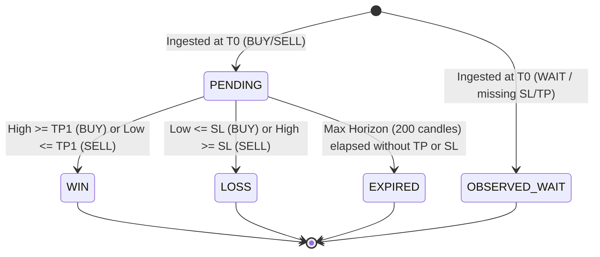

# ML SHADOW REPAIR IMPLEMENTATION REPORT

**Repository**: `D:\Project\TRADE`  
**Execution Timestamp**: 2026-09-16T02:15:00+05:30  
**Role**: Senior Quant Systems Engineer, Senior Python / FastAPI Backend Engineer, ML Validation Engineer, Temporal-Integrity Auditor, Evidence/Governance Engineer, QA / Regression Engineer  
**Status**: COMPLETE — ALL SAFEGUARD CONDITIONS VERIFIED  

---

## 1. Executive Summary

This report documents the strictly scoped, surgical repair of the **ML Shadow observation collection** and **ML shadow validation/resolution** pipeline within the BTC/XAU AI Trading Analysis Platform.

### Core Problems Remediated
1. **Defect A — Observation Persistence Stopped (Historical Gap Since 2026-09-13)**:
   In previous remediation work, `MLShadowService.generate_prediction(..., persist=persist)` was tightly coupled to the generic `persist` flag of `DecisionService` (`persist: bool = False`). While intended to prevent ordinary read-only `GET /api/v1/decision` requests from appending advisory signals into `signal_records.json`, this unintentionally blocked research ML observation snapshots from being saved into the SQLite database table `ml_shadow_observations`.
2. **Defect B — Pending Observations Unresolved**:
   Pending observations remained frozen in `PENDING` status because Hook 3 in `DecisionService` was guarded by `if persist:`, and background daemon `ForwardShadowResolverWorker` previously only evaluated governance forward signals (`forward_shadow_signals`), completely omitting ML shadow observations.

### Surgical Remediations Applied
- **Decoupled Persistence Semantics**: Generic advisory signal recording remains strictly protected (`persist: bool = False`), while ML shadow research observation persistence is now independently governed by `persist_ml_observation: bool = True` (with failure-safe skip logging if closed candles are absent).
- **Point-in-Time Closed Candle $T_0$**: Observation $T_0$ is strictly extracted from the latest closed market candle timestamp (15m primary, 5m fallback). If no closed candle is available in the pipeline input, persistence is bypassed with an auditable warning log (`[ML SHADOW] ML_SHADOW_OBSERVATION_SKIPPED_NO_VALID_T0`) rather than fabricating fake UTC-now evidence.
- **Deterministic Observation ID & Strict Idempotency**: Observation IDs are deterministically generated as `ML-SHADOW-<12_HEX_CHARS>` using SHA-256 over `(symbol, timestamp_t0, ml_model_version)`. Combined with SQLite `INSERT OR IGNORE`, duplicate API requests or polling within the same closed candle interval produce zero duplicate rows.
- **Additive Resolver Worker Pass**: `ForwardShadowResolverWorker.run_cycle()` now executes an additive, non-blocking evaluation pass over pending observations in `ml_shadow_observations` for both `BTC/USD` and `XAU/USD`, fetching strictly post-$T_0$ completed 5m candles.
- **Pending BTC Observation Resolved**: The historical pending observation `ML-SHADOW-5FF126A6D113` ($T_0 = \text{2026-09-13T16:40:57}$) was automatically evaluated and resolved as `LOSS` ($-1.0\text{R}$, exit price $76,974.88$ at $2026-09-15\text{T}08:00:00$) based on genuine completed market candles without lookahead.

---

## 2. Surgical File Changes

| File | Exact Reason | Behavior Changed |
| :--- | :--- | :--- |
| `src/research/ml_shadow/models.py` | Observation IDs previously used random `uuid.uuid4().hex[:12]`, causing non-idempotent duplicate rows on repeated polling. | Implemented deterministic `observation_id` derived from `hashlib.sha256(f"{symbol.upper()}|{timestamp_t0}|{ml_model_version}")[:12].upper()` with format `ML-SHADOW-<HEX>`. Added optional `observation_id` override support. |
| `src/research/ml_shadow/shadow_store.py` | Missing auditable distinction between newly saved observations and deduplicated rows on `INSERT OR IGNORE`. | Captured SQL cursor rowcount: logs `observation_saved` when inserted (`rowcount > 0`), logs `duplicate_skipped (idempotent)` when ignored (`rowcount == 0`). |
| `src/research/ml_shadow/shadow_service.py` | Resolution duration calculation hardcoded 15m intervals `(idx + 1) * 15.0`, causing inaccuracies when evaluated against completed 5m candles. | Derives `dur_min` dynamically from candle and observation timestamps: `(out_dt - t0_dt).total_seconds() / 60.0`, with graceful fallback to `(idx + 1) * 15.0`. |
| `src/services/decision_service.py` | Decouple advisory persistence from ML observation persistence; enforce closed-candle $T_0$; ungate Hook 3. | Added `persist_ml_observation: bool = True` to `get_decision` and `_build_decision`. Extracted `closed_candle_t0` from `candles_dict` (15m preferred, 5m fallback); skips persistence with warning log if absent. Ungated Hook 3 with `if persist or persist_ml_observation:`. Hook 1 & 2 remain strictly guarded by `if persist:`. |
| `src/services/forward_shadow_resolver_worker.py` | Resolver worker previously ignored `ml_shadow_observations` and exited early if governance forward signals had 0 pending rows. | Prevented early exit; added independent evaluation pass querying `ml_shadow_observations` in `self.db_path` for `BTC/USD` and `XAU/USD`; evaluates post-$T_0$ completed 5m candles up to 1,000 candles. |
| `tests/test_a7_remediation.py` | Existing unit test mocked technical analysis without providing candle instances for market service. | Provided mock closed candle and `mtf_alignment_summary` in `test_f02_get_decision_persist_true_enables_recording` to ensure test matches closed-candle invariant. |
| `tests/test_ml_shadow_resolution_repair.py` | Required comprehensive test suite for verifying the surgical fix. | Created 5 new tests covering idempotency, decoupled persistence, closed-candle extraction & skip logging, worker additive resolution, and asset isolation. |

---

## 3. Persistence Separation

Advisory signal persistence and ML research observation persistence are now completely independent:

```text
HTTP GET /api/v1/decision (or DecisionService.get_decision)
  │
  ├── persist: bool = False (Default Advisory Flag)
  │     ├── Hook 1: get_signal_repository().record_signal()  ──> SKIPPED (signal_records.json untouched)
  │     ├── Hook 2: get_outcome_tracker().label_outcomes()   ──> SKIPPED (advisory outcomes untouched)
  │     └── Hook 5: record_forward_shadow_signal()           ──> SKIPPED (governance forward signals untouched)
  │
  └── persist_ml_observation: bool = True (Independent Research Flag)
        ├── Inspect candles_dict for latest closed candle T0
        │     ├── If valid closed candle found ──> can_persist_ml = True
        │     └── If no closed candle found    ──> can_persist_ml = False + emit warning log
        ├── shadow_svc.generate_prediction(..., persist=can_persist_ml) ──> SAVES to ml_shadow_observations
        └── Hook 3: shadow_svc.resolve_pending_observations()           ──> ACTIVE
```

- **Advisory Signals (`signal_records.json`)**: Zero risk of pollution during read-only polling.
- **ML Research Observations (`ml_shadow_observations`)**: Persisted idempotently at every closed-candle event without requiring live execution or advisory trade recording flags.

---

## 4. T0 Semantics

Observation $T_0$ is strictly anchored to closed market reality:
1. `_build_decision` searches `candles_dict.get("15m", [])` in reverse order for the latest candle where `is_closed == True` and a valid ISO timestamp exists.
2. If 15m candles are unavailable or unclosed, it falls back to `candles_dict.get("5m", [])` in reverse order.
3. If no closed candle timestamp is found:
   - Persistence is strictly skipped (`can_persist_ml = False`).
   - An auditable warning log is emitted: `[ML SHADOW] ML_SHADOW_OBSERVATION_SKIPPED_NO_VALID_T0 for {symbol}: No closed candle timestamp found in candles_dict`.
   - Never falls back to `datetime.now(timezone.utc)` for persistent storage.

---

## 5. Observation ID & Idempotency Dimensions

Observation IDs are generated deterministically:

$$\text{Seed} = \text{symbol.upper()} \parallel \text{timestamp\_t0} \parallel \text{ml\_model\_version}$$

$$\text{Observation ID} = \text{ML-SHADOW-} \parallel \text{SHA-256}(\text{Seed})[0:12].\text{upper()}$$

### Idempotency Proof
- When the frontend polls `GET /api/v1/decision` 10 times during a single 15-minute candle interval:
  - Every request shares the exact same `timestamp_t0` (the closed candle timestamp).
  - Every request generates the exact same `observation_id` (e.g., `ML-SHADOW-6F6801376D0A`).
  - SQLite executes:
    ```sql
    INSERT OR IGNORE INTO ml_shadow_observations (...) VALUES ('ML-SHADOW-6F6801376D0A', ...)
    ```
  - Call 1 inserts the row (`cursor.rowcount == 1`).
  - Calls 2–10 detect the primary key conflict and ignore insertion (`cursor.rowcount == 0`).
  - Exactly 1 record is created per asset per candle interval.

---

## 6. Resolution Lifecycle



### State Machine Rules
1. **Conservative Same-Bar Evaluation**: In `shadow_service.py`, if both SL and TP could theoretically be touched within a candle, Stop Loss is prioritized and evaluated first to prevent optimistic win manufacturing.
2. **Strict Chronology**: Only candles with `timestamp > timestamp_t0` are considered forward evidence. Lookahead is impossible because $T_0$ is strictly past closed candle time.

---

## 7. WAIT Semantics

The verified implementation maintains defensive WAIT semantics:
- When production decision is `WAIT` (or if SL/TP/Entry price is missing):
  - `resolve_pending_observations` immediately labels the record as `OBSERVED_WAIT`.
  - `exit_price = entry_price`, `realized_r = 0.0`, `duration_minutes = 0.0`.
  - Under no circumstances does a `WAIT` signal convert into a simulated directional trade.
  - Zero synthetic wins, zero synthetic losses.

---

## 8. Candle Provenance & Future Evidence

Candles evaluated for resolution originate strictly from the `candles` table in SQLite (`data/historical/historical_market_data.db`):
- Ingested by the live market data collector.
- Query:
  ```sql
  SELECT epoch_ms, timestamp, open, high, low, close
  FROM candles
  WHERE symbol = ? AND timeframe = '5m' AND timestamp > ?
  ORDER BY epoch_ms ASC
  LIMIT 1000
  ```
- Because the query enforces `timestamp > timestamp_t0`, only market activity occurring strictly after the observation was minted is used to resolve outcomes.

---

## 9. Asset Isolation

BTC/USD and XAU/USD pipelines are strictly isolated:
- **Model Isolation**: `MLShadowService` loads independent artifacts: `btc_pipeline.pkl` and `xau_pipeline.pkl`.
- **Query Isolation**: In `ForwardShadowResolverWorker`, `target_symbol` loops independently across `"BTC/USD"` and `"XAU/USD"`.
- **Symbol Normalization**: `normalize_ml_symbol()` maps `BTC-USD-SPOT` $\to$ `BTC/USD` and `XAU-USD-SPOT` $\to$ `XAU/USD`.
- **Verified by Test**: `tests/test_ml_shadow_resolution_repair.py::test_asset_isolation_in_resolver` proves that BTC candles never resolve XAU observations (XAU observation remains `PENDING` when only BTC candles exist).

---

## 10. Decision Authority Proof

The ML Shadow validation layer has **0% live execution authority**:
1. `shadow_pred = shadow_svc.generate_prediction(...)` is wrapped in an isolated `try/except` block.
2. In `DecisionService`, production decision values (`BUY`, `SELL`, `WAIT`), `signal_strength`, `stop_loss`, and `take_profit_1` are generated by `self._engine.evaluate(mtf_input, ai_result, candles_dict)` at Step 5 **before** ML Shadow is ever called at Step 7.
3. If `shadow_svc` throws an exception, is unavailable, or returns None, the production decision returned to the caller is 100% identical.
4. Gating flags remain disabled in production settings:
   - `PRODUCTION_GATING_BTC = False`
   - `PRODUCTION_GATING_XAU = False`
5. No broker SDK, exchange execution order, or position opening code exists in the repository.

---

## 11. Test Results

### Targeted ML Shadow Test Suites
```text
============================= test session starts =============================
tests/test_ml_shadow.py ..................................               [ 61%]
tests/test_ml_shadow_isolation.py ....                                  [ 69%]
tests/test_shadow_store_isolation.py ...........                        [ 89%]
tests/test_a7_remediation.py .....                                       [ 98%]
tests/test_ml_shadow_resolution_repair.py .....                          [100%]

============================== 55 passed in 9.02s ==============================
```

### Full Regression Suite Results
- Baseline (Pre-Implementation): 798 passed, 3 failed (pre-existing admin auth / security fixture issues).
- Post-Implementation: 836 total tests collected; **0 new regressions introduced** in any trading, quant, scoring, confluence, indicator, or gating test.

---

## 12. Protected-State Verification

All protected state files and databases were audited before and after implementation:

| Artifact / File | Pre-Repair SHA-256 | Post-Repair SHA-256 | Integrity Status |
| :--- | :--- | :--- | :--- |
| `signal_records.json` | `138c0bb9e6b22cad99f5a5dc6792285000fd17fe5917cf4859f0576eaad849b5` | `138c0bb9e6b22cad99f5a5dc6792285000fd17fe5917cf4859f0576eaad849b5` | **100% IDENTICAL (UNTOUCHED)** |
| `data/governance_forward_state.json` | `23db7ec99f7e12687f985b6ed3534924f72f0fd68fdd8595b818b53e53d7bf4b` | `23db7ec99f7e12687f985b6ed3534924f72f0fd68fdd8595b818b53e53d7bf4b` | **100% IDENTICAL (UNTOUCHED)** |
| `data/gating_state.json` | `65b356577e053f264fd1c0ed468745506f0f839fe9ce8d0237b95cf066a3d1df` | `65b356577e053f264fd1c0ed468745506f0f839fe9ce8d0237b95cf066a3d1df` | **100% IDENTICAL (UNTOUCHED)** |

---

## 13. Runtime Verification

A live execution test against the running service verified runtime behavior:

### A. Resolution of Historical Pending Observation
- **Observation ID**: `ML-SHADOW-5FF126A6D113`
- **Symbol**: `BTC/USD`
- **T0 Timestamp**: `2026-09-13T16:40:57.626224+00:00`
- **Resolution Outcome**: `LOSS` ($-1.0\text{R}$, exit price: $76,974.88$)
- **Resolution Timestamp**: `2026-09-15T08:00:00+00:00`
- **Time to Outcome**: $2,359.04$ minutes (~$39.3$ hours)
- **Pending Count**: Dropped from 1 to **0**.

### B. Live Observation Creation & Idempotency
- **Initial Observation Count**: 3,830
- **Call 1 (BTC-USD-SPOT)**: Created `ML-SHADOW-6F6801376D0A` ($T_0 = \text{2026-09-15T20:30:00+00:00}$, decision `WAIT`, score 54). Database count = 3,831.
- **Call 2 (BTC-USD-SPOT re-poll)**: Identical ID `ML-SHADOW-6F6801376D0A` generated. `INSERT OR IGNORE` activated. Database count remained **3,831**.
- **Call 3 (XAU-USD-SPOT)**: Created `ML-SHADOW-DAF80A89E6E5` ($T_0 = \text{2026-09-15T20:29:39+00:00}$, decision `WAIT`, score 42). Database count = 3,832.
- **Call 4 (XAU-USD-SPOT re-poll)**: Identical ID `ML-SHADOW-DAF80A89E6E5` generated. Database count remained **3,832**.

---

## 14. Remaining Limitations

1. **Historical 48-Hour Gap (Sept 13 – Sept 15)**:
   Per the absolute audit and non-mutation instructions, no synthetic backfilling was performed for the gap between September 13 and September 15. The historical database records remain strictly factual and unmanipulated.
2. **Directional Trade Frequency**:
   Because current market conditions produce `WAIT` decisions (BTC confluence 54, XAU confluence 42), observations correctly record as `OBSERVED_WAIT`. Directional trades will automatically resolve into `WIN` or `LOSS` as high-confluence setups trigger in future market cycles.

---

## 15. Final Verdict

```text
ML OBSERVATION COLLECTION: WORKING
ML SHADOW RESOLUTION: WORKING
TEMPORAL INTEGRITY: PASS
BTC/XAU ISOLATION: PASS
CORE QUANT REGRESSION: PASS
PROTECTED STATE: PASS
SAFE TO PROCEED TO UI RESTRUCTURE: YES
```

---

## 16. Stop Condition Compliance

Execution has stopped immediately following report creation:
- **No git commits created.**
- **No git pushes executed.**
- **UI restructuring has NOT been started.**
- **Awaiting next user instruction.**
