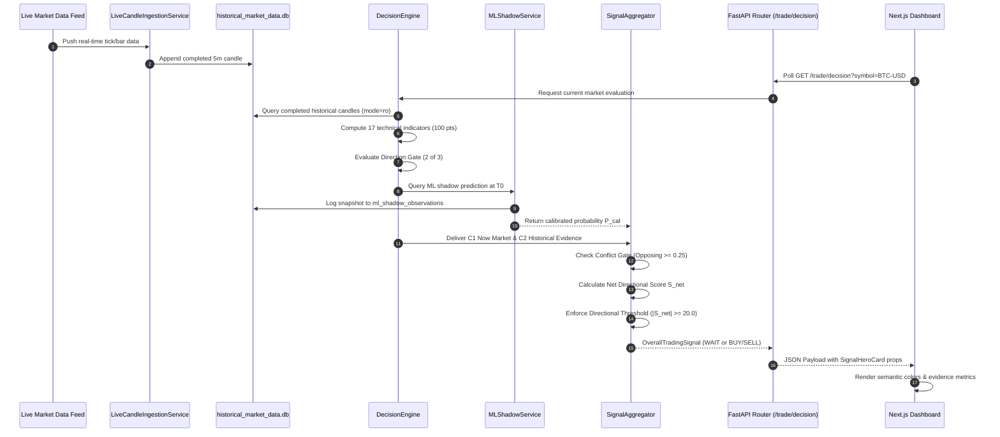

# DATA FLOW SPECIFICATION

**System**: BTC/USD & XAU/USD Quantitative AI Trading Analysis Platform  
**Document Classification**: End-to-End Data Lifecycle & Information Pipeline  

---

## 1. End-to-End Lifecycle Sequence

---

## 2. Ingestion & Storage Pipeline

1. **Market Data Polling & Catch-up**:
   - `LiveCandleIngestionService` runs on a background scheduler every 5 minutes.
   - Computes UTC timestamp difference from the last recorded closed candle to current UTC time.
   - Fetches completed candles via public exchange REST APIs (Coinbase for BTC, Yahoo/OANDA for XAU).
   - Writes new candles into `candles` table in `data/historical/historical_market_data.db`.

2. **Historical Core Data**:
   - `data/historical/historical_market_data.db` holds 9.6M+ completed candles spanning 2018 to 2026.
   - Read operations use read-only SQLite URIs (`?mode=ro`).

---

## 3. Decision & Evidence Synthesis Pipeline

1. **Feature Calculation**:
   - Indicators are strictly point-in-time: moving averages and oscillators are calculated using closed candles only ($t \le T_0$).
2. **Component Evaluation**:
   - **C1 (Now Market)**: Confluence of technical indicators + Gemini 10-pt sanity check.
   - **C2 (Historical Evidence)**: Bayesian historical win rate and expectancy lookup from 2,438 backtested signal matches.
   - **C3 (ML Shadow)**: Scaled feature vector fed into pre-trained frozen model (`v1.0.0-research`). Produces raw probability $P_{raw}$ and Platt-calibrated $P_{cal}$.
   - **C4 (Strategy Layer)**: Historical rule-based strategy degradation check.
3. **Fusion & Invariant Enforcement**:
   - Weighted combination using frozen weights (BTC: 25/27/26/22, XAU: 27/26/24/23).
   - If opposing components $\ge 0.25$ $\rightarrow$ Hard `WAIT`, `percentage=None`, `conflict_detected=True`.
   - If $|S_{net}| < 20.0$ $\rightarrow$ `WAIT`, `percentage=None`.
   - If Direction Gate fails $\rightarrow$ `WAIT`, `percentage=None`.

---

## 4. Forward Shadow Lifecycle Pipeline

1. **Snapshot Creation ($T_0$)**:
   - Whenever an actionable signal ($S \ne \text{WAIT}$) is produced, `ForwardShadowEngine` captures an immutable record with SHA-256 hash in `forward_shadow_signals`.
2. **Automated Trade Resolution ($T_{exit}$)**:
   - Subsequent 5-minute candles check whether $P_{high} \ge \text{TakeProfit}$ or $P_{low} \le \text{StopLoss}$.
   - Realized $R$, MFE, and MAE are updated automatically.
   - Deletion is impossible: records transition from `PENDING` $\rightarrow$ `RESOLVED_WIN` / `RESOLVED_LOSS`.
